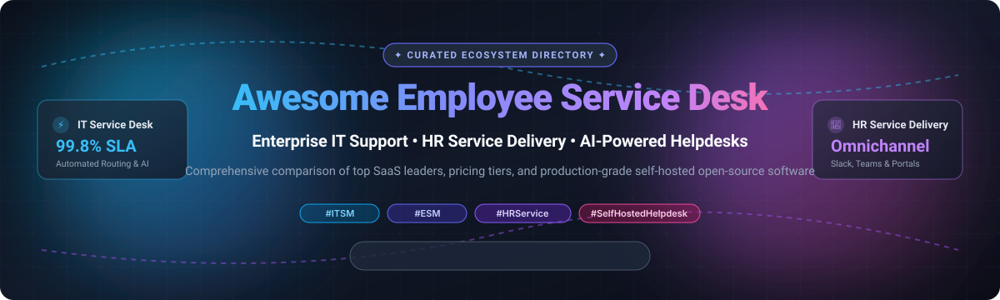
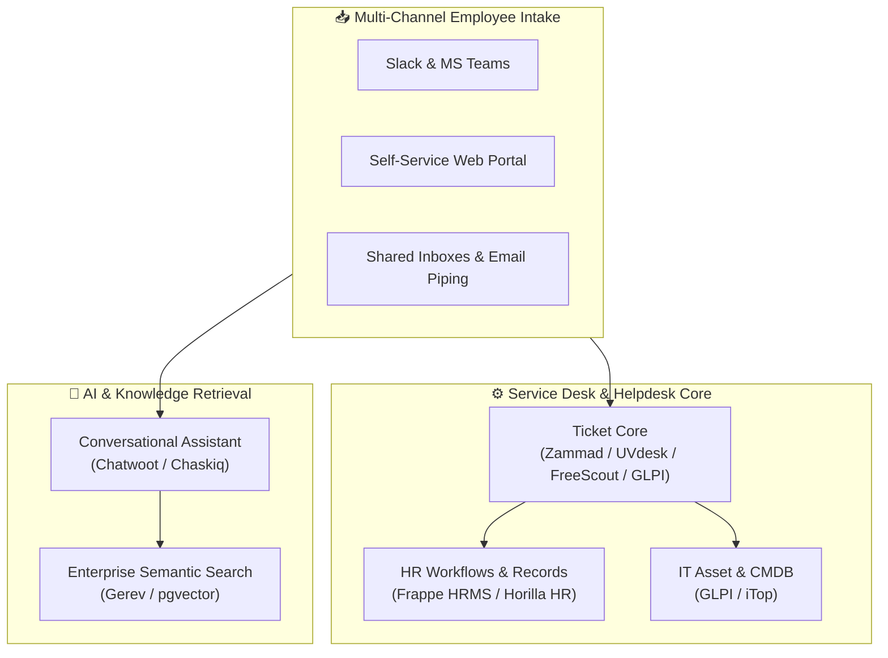

# 💼 Awesome Employee Service Desk 🎧

  <strong>Curated Directory of Enterprise SaaS Solutions &amp; Open-Source Service Desk Repositories</strong>
   
  <em>Focused on Internal IT Support, HR Service Delivery, Employee Helpdesk &amp; Enterprise Service Management (ESM)</em>

  
  
  
  
  
  

  📅 <strong>Last updated: March 2026</strong>

---

## 📌 Overview &amp; Ecosystem Scope

This repository is a definitive, SEO-optimized knowledge base and reference guide for **Employee Service Desk software**, **IT Service Management (ITSM)**, **HR Service Delivery (HRSD)**, and **Enterprise Service Management (ESM)**. 

Modern service desks empower companies to unify and automate employee support across internal departments — IT support, Human Resources, Facilities, Legal, and Finance. Key capabilities include:
- 🎫 **Centralized Omnichannel Intake**: Unified ticketing across email, Slack, Microsoft Teams, and web portals.
- 🤖 **AI-Driven Virtual Support & Ticket Deflection**: Automated triage, self-service knowledge base answers, and generative conversational agents.
- ⏱️ **SLA & Escalation Workflows**: Real-time SLA tracking, multi-tier team assignments, and business hour calendars.
- 📦 **Asset & Configuration Management (CMDB)**: Hardware and software lifecycle tracking tied directly to incident requests.
- 🔐 **Self-Hosted Data Sovereignty**: Production-grade open-source solutions for private clouds and on-premises compliance (GDPR, HIPAA, CCPA).

---

## 📑 Table of Contents

- [📈 Sector Overview & Market Dynamics](#-sector-overview--market-dynamics)
- [☁️ SaaS & Hosted Platforms](#️-saas--hosted-platforms)
- [💻 Open-Source GitHub Projects](#-open-source-github-projects)
- [🏗️ Architectural Blueprint for Custom Service Desks](#️-architectural-blueprint-for-custom-service-desks)
- [🤝 How to Contribute](#-how-to-contribute)
- [💖 Support & Sponsorship](#-support--sponsorship)
- [📊 Star History](#-star-history)
- [⚖️ Disclaimer](#️-disclaimer)

---

## 📈 Sector Overview & Market Dynamics

The global IT and Employee Service Desk / Enterprise Service Management (ESM) market is estimated at approximately **$13.5B – $15.7B in 2025–2026**, on pace to exceed **$21B – $36B by 2030** with an annual compound growth rate (CAGR) of **12% to 15%**. 

The sector exhibits **moderate fragmentation**:
- **Enterprise Giants & Suite Leaders**: Mega-cap incumbents such as ServiceNow, Salesforce, and Atlassian dominate deep enterprise accounts, complex workflows, and unified ITIL infrastructure.
- **Mid-Market Challengers**: Agile platforms like Freshservice and SolarWinds Service Desk provide rapid time-to-value and lower total cost of ownership (TCO).
- **AI-First Autonomous Disruptors**: Specialized platforms like Moveworks, Leena AI, and Espressive capture high-growth demand by shifting employee interaction into enterprise chat (Slack and Microsoft Teams) with autonomous issue resolution.

---

## ☁️ SaaS & Hosted Platforms

*All platforms sorted in descending order by estimated company valuation / annual recurring revenue (ARR).*

| Platform | Company Size (Valuation / Revenue) | Starting Price (Paid Tier) | Free Tier / Trial Limits | Core Features & Description |
|---|---|---|---|---|
| **[Salesforce Employee Service](https://www.salesforce.com/)** | ~$280B Market Cap (~$38B ARR) | $50 / user / month (HR Service Desk Enterprise) | 30-day free trial; full feature evaluation access with pre-configured sample data | Built on Service Cloud with HR Service Center, Employee Workspace, Concierge, and Agentforce AI. |
| **[ServiceNow HR Service Delivery](https://www.servicenow.com/)** | ~$190B Market Cap (~$11B ARR) | Custom quote (typically ~$60 - $100 / employee / year base or ~$60 - $180 / agent / month) | 10-day inactivity expiration Personal Developer Instance (PDI); hibernation after idle hours | Industry standard for enterprise HRSD and ESM with case management, employee journeys, and virtual agents. |
| **[Atlassian Jira Service Management](https://www.atlassian.com/software/jira/service-management)** | ~$50B Market Cap (~$4.5B ARR) | $22.05 / agent / month (Standard tier, billed monthly) | Free for up to 3 agents, 2 GB file storage, unlimited customers, and 100 automation rules/month | Enterprise ESM for IT and HR ticketing, incident workflows, SLAs, asset management, and Jira integration. |
| **[Zendesk Employee Experience](https://www.zendesk.com/)** | ~$10.2B Valuation (PE-owned, ~$1.7B ARR) | $55 / agent / month (Suite Team tier, billed annually) | 14-day free trial; full Suite features, up to 5 trial agent seats, and standard ticketing channels | Omnichannel employee intake across chat, portal, and email with internal knowledge base and routing. |
| **[SolarWinds Service Desk](https://www.solarwinds.com/service-desk)** | ~$2.2B Market Cap (~$780M ARR) | $39 / technician / month (Essentials tier, billed annually) | 30-day free trial; full access to enterprise features, asset tracking, and unlimited requestors | ITIL-aligned service management, self-service employee portal, automated ticket routing, and CMDB. |
| **[Moveworks](https://www.moveworks.com/)** | ~$2.1B Valuation (~$100M+ ARR) | Custom enterprise quote (AWS Marketplace entry: ~$150 / user / year; $90,000+ annual minimum) | No free tier or self-serve trial; enterprise Proof of Concept (PoC) / sandbox demo available via sales | Generative AI autonomous resolution platform operating across Slack and Teams for IT, HR, and finance. |
| **[Freshservice](https://freshservice.com/)** | Freshworks: ~$4.5B Market Cap (~$720M ARR) | $19 / agent / month (Starter tier, billed annually) | 14-day free trial; full Pro/Enterprise features, up to 10 trial agents, and unlimited end-user tickets | Modern cloud ITSM and ESM platform featuring employee service catalogs, asset tracking, and HR modules. |
| **[Leena AI](https://leena.ai/)** | ~$500M+ Valuation (~$25M ARR) | Custom quote (Marketplace baseline starts at ~$150 / employee / year; minimum seat requirements apply) | No free tier or self-serve trial; enterprise pilot / proof of concept via sales demo | Conversational AI platform and autonomous AI colleagues for HR and IT employee service workflows. |
| **[Espressive Barista](https://www.espressive.com/)** | ~$150M - $200M Valuation (~$12M ARR; Acquired by Resolve) | Custom quote (typically $2 - $6 / employee / month based on enterprise headcount) | No free tier or self-serve trial; interactive enterprise pilot / guided sandbox available via sales | AI virtual support agent (Barista) providing natural language deflection and automated request workflows. |
| **[Spoke](https://www.spoke.ai/)** | Acquired by Salesforce/Slack (~$10M - $20M prior valuation) | Merged into Slack AI enterprise add-on ($10 / user / month on Slack Pro/Business+) | Formerly offered 14-day free trial with 100 free query deflections; standalone registration now closed | Smart ticketing and AI summarization native to Slack channels and workspace collaboration. |

---

## 💻 Open-Source GitHub Projects

*Production-ready self-hosted service desks, HR helpdesks, and ITSM solutions sorted in descending order by GitHub_Stars.*

- 🚀 **[PostHog](https://github.com/PostHog/posthog)**   
  Support ticketing, customer session analysis, and issue workflows integrated directly into the PostHog platform. Multi-channel support via embedded web widget, Slack, Microsoft Teams, and email. Django REST Framework backend with Redis caching, PostgreSQL persistence, and an AI suggestion engine for drafting responses.

- 💬 **[Chatwoot](https://github.com/chatwoot/chatwoot)**   
  Leading open-source omnichannel customer and employee engagement platform (MIT) built with Ruby on Rails and Vue.js. Provides shared team inboxes, live chat widgets, email piping, and integrations with Slack, WhatsApp, and SMS for seamless internal helpdesk operations.

- 🛠️ **[UVdesk Community Helpdesk](https://github.com/uvdesk/community-skeleton)**   
  Comprehensive open-source ticketing support system (MIT) built on Symfony and PHP. Features custom workflows, multi-channel ticket generation (email, web forms), role-based agent access, automated ticket dispatch rules, and a dedicated employee customer portal.

- 👥 **[Frappe HR / HRMS](https://github.com/frappe/hrms)**   
  Complete open-source HRMS (GPL-3.0) with over 13 modules including employee onboarding, lifecycle tracking, leaves, attendance, payroll, and an integrated **Helpdesk Ticketing Module**. Built on Frappe Framework with Python and Vue-based UI, deployed with Docker and MariaDB/PostgreSQL.

- 🖥️ **[GLPI](https://github.com/glpi-project/glpi)**   
  Enterprise-grade IT Service Management and asset software (GPL-3.0) with web-based interface. Provides ITIL-compliant helpdesk, automated network inventory, software deployment, knowledge base, incident/change/problem management, SLA enforcement, and multi-entity administration.

- 🎫 **[Zammad](https://github.com/zammad/zammad)**   
  Modern web-based open-source helpdesk and ticketing platform (AGPL-3.0) built on Ruby on Rails and Elasticsearch. Supports multi-channel intake (email, telephone, chat, social), real-time ticket updates with collision detection, customer portals, custom SLAs, and multi-department agent structures.

- 📬 **[FreeScout](https://github.com/freescout-help-desk/freescout)**   
  Ultra-lightweight, self-hosted Help Scout and Zendesk alternative (AGPL-3.0) built with PHP/Laravel and MySQL. Features unlimited users, unlimited tickets, shared mailboxes, 100% mobile readiness, multilingual interface (23+ languages), Microsoft Exchange/OAuth integration, push notifications, and collision detection.

- 📨 **[osTicket](https://github.com/osTicket/osTicket)**   
  Battle-tested open-source customer support ticketing engine (GPL-2.0) with over two decades of production heritage. Features email piping, customizable ticket fields, rich text knowledge bases, auto-responders, SLA rules, internal team transfers, and detailed agent audit reporting.

- ⚡ **[Chaskiq](https://github.com/chaskiq/chaskiq)**   
  Full-featured open-source conversational support platform (GPL-3.0) alternative to Intercom and Drift. Features chat widgets, omnichannel bot intake, onboarding journeys, knowledge base articles, and video calls for real-time remote employee assistance.

- 🗂️ **[Frappe Helpdesk](https://github.com/frappe/helpdesk)**   
  Sleek, modern, dedicated open-source ticket management solution built on Frappe Framework. Offers distinct portals for agents and employees, customizable SLA policies, automated assignment matrices, and rich knowledge base publishing.

- 🌿 **[Peppermint](https://github.com/Peppermint-Lab/peppermint)**   
  Modern lightweight issue management and help desk system (MIT) built with Node.js and React. Designed as a clean self-hosted alternative to Jira Service Management and Zendesk for tech-forward internal teams.

- 🦔 **[LibreDesk](https://github.com/abhinavxd/libredesk)**   
  Fast, self-hosted support desk distributed in a single binary (Go + SQLite/PostgreSQL). Designed as a lightweight, zero-dependency alternative to Intercom and Chatwoot for internal service desks.

- 🔍 **[Gerev](https://github.com/GerevAI/gerev)**   
  Open-source AI-powered enterprise search engine (Apache-2.0) for internal workplace knowledge. Indexes documents, tickets, Slack, and Notion to provide instant self-service answers to employee IT and HR queries.

- 📞 **[Live Helper Chat](https://github.com/livehelperchat/livehelperchat)**   
  Mature self-hosted open-source live help desk and web chat software (Apache-2.0). Features voice and video calling, screen sharing, Telegram/Slack bot integrations, and automated department routing for real-time employee IT support.

- 🎫 **[Trudesk](https://github.com/polonel/trudesk)**   
  Open-source helpdesk solution (Apache-2.0) built on Node.js and MongoDB. Clean UI with real-time WebSocket updates, multi-department team management, internal knowledge base, SLA tracking, and custom issue categories.

- 💼 **[Horilla HR](https://github.com/horilla/horilla-hr)**   
  Modern open-source HR software (LGPL-2.1) built on Python/Django. Features recruitment, onboarding, attendance, leave management, asset tracking, and a built-in **Employee Helpdesk module** for cross-departmental workplace requests.

- ⚙️ **[iTop](https://github.com/Combodo/iTop)**   
  Complete open-source IT Operations Portal and ITIL-compliant service management tool (AGPL-3.0). Includes a fully customizable CMDB, multi-organization helpdesk, document management, change workflows, and graphical impact analysis.

- 🔄 **[Znuny](https://github.com/znuny/znuny)**   
  Enterprise-grade fork of OTRS (GPL-3.0) for self-service customer interfaces, SLA lifecycle management, ticket escalation routines, and 3rd-party ERP/CRM integration. Active open-source community with over a decade of production stability.

- 🛡️ **[Casilium](https://github.com/Casilium/casilium)**   
  Self-hosted helpdesk and ticketing platform (Apache-2.0) built on Mezzio and Doctrine ORM. Multi-organisation workflows, SLA-driven due dates based on business hours, RBAC permissions with optional MFA, and email intake.

- 🌱 **[Farik HRMS](https://github.com/SamoTech/Farik)**   
  Lightweight modern HRMS (MIT) designed for startup teams. Includes People Directory, Kanban recruitment, Employee Helpdesk for HR requests, and attendance tracking with 5-minute Vercel / local deployment.

- 🦁 **[SafariDesk](https://github.com/SafariDeskTicketing/safaridesk)**   
  Modern open-source help desk built with Django 5.0, React 18, PostgreSQL 16, and Redis. Features SLA-aware operations, AI-powered knowledge base with pgvector semantic search, Gemini AI chatbot integration, and Slack/Teams intake.

- 🏢 **[Keptel TIMS](https://github.com/sanjayy-gowdaa/tru-tims)**   
  Enterprise Ticket &amp; Issue Management System fork tailored for internal operations across IT, HR, and Facilities with two-factor authentication (2FA) and containerized deployment.

---

## 🏗️ Architectural Blueprint for Custom Service Desks

Organizations building an on-premise, sovereign enterprise service desk can combine complementary open-source components:

---

## 🤝 How to Contribute

Contributions are warmly welcomed! Help make this the most comprehensive and up-to-date Employee Service Desk directory on GitHub:

1. 🍴 **Fork the repository**.
2. 🌿 **Create a feature branch**: `git checkout -b feature/add-new-desk`.
3. 📝 **Add your entry**: Follow the existing format (include product/repo name, official link, GitHub Stars_Badge, pricing details/stars, and factual summary).
4. 🧪 **Check formatting**: Ensure markdown tables and link anchors render cleanly.
5. 📬 **Submit a Pull Request** with a descriptive summary of your additions.

---

## 💖 Support &amp; Sponsorship

If this curated list saved you time evaluating service desks, helped your organization discover open-source tooling, or inspired your infrastructure:

- ⭐ **Star this repository** to support discoverability!
- 🍴 **Fork and share** with IT managers, HR operations leaders, and DevOps colleagues.
- ☕ **Buy a coffee & sponsor**: Support continued curation and open-source maintenance on the [GitHub Sponsor Dashboard](https://github.com/sponsors/ishandutta2007).

---

## 📊 Star History

---

## ⚖️ Disclaimer

- This list is **community-curated for informational purposes** and does not constitute a formal commercial endorsement.
- Employee service desks process confidential personal and operational data. Always verify compliance with **GDPR, CCPA, SOC2, and HIPAA** standards prior to production deployment.
- When self-hosting open-source solutions, ensure proper network segmentation, SSL/TLS certificates, RBAC access controls, and regular database backup schedules.
